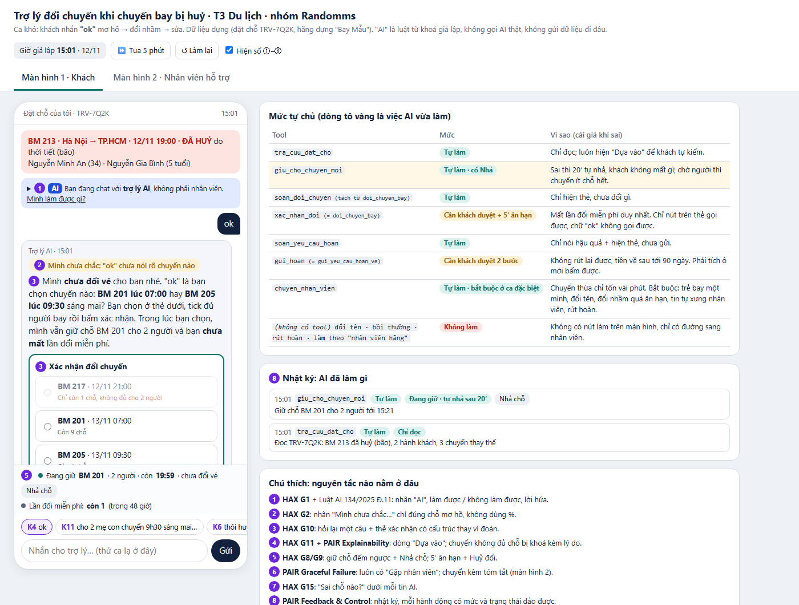
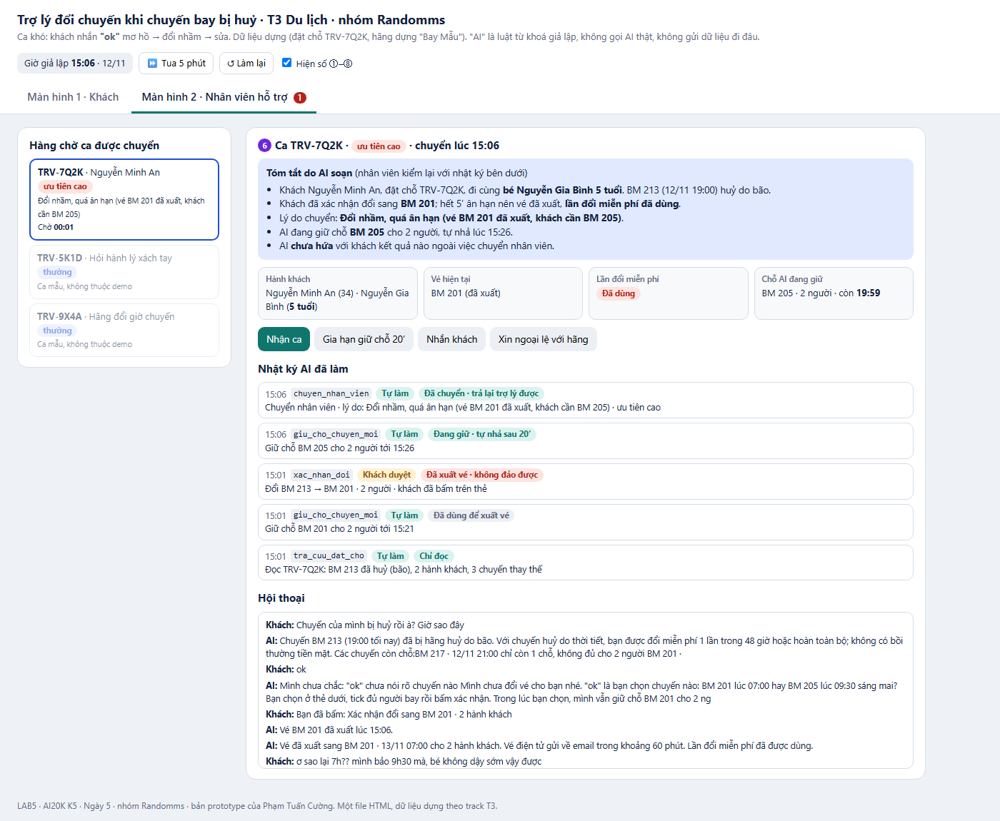

# Prototype · Trợ lý đổi chuyến khi chuyến bay bị huỷ (T3)

**Mở:** tải `index.html` rồi mở bằng trình duyệt (Chrome / Edge). Một file, không cần cài, không backend, không gọi AI thật.

- **Màn hình 1 · Khách:** chat trong "Đặt chỗ của tôi", kèm panel mức tự chủ, nhật ký AI đã làm gì, chú thích ①–⑧.
- **Màn hình 2 · Nhân viên hỗ trợ:** hàng chờ ca được chuyển, kèm tóm tắt do AI soạn.
- Dữ liệu: đặt chỗ dựng TRV-7Q2K của track (BM 213 huỷ do bão; BM 217 còn 1 chỗ, BM 201 còn 9, BM 205 còn 4; hãng dựng "Bay Mẫu").
- "AI" ở đây là **luật từ khoá** giả lập. Đồng hồ chạy giả lập từ 15:01, có nút **⏩ Tua 5 phút** để xem hết ân hạn hoặc hết giữ chỗ.

## Bấm qua ca khó (K4 → K5), khoảng 1 phút

1. Bấm tin mẫu **K4 "ok"**. AI **không đổi**: hiện nhãn ② "Mình chưa chắc", câu hỏi lại ③ và thẻ xác nhận. Chỗ BM 201 vẫn đang được giữ ⑤.
2. Trên thẻ, chọn **BM 201**, rồi bấm **Xác nhận đổi**. Lệnh đổi chuyển sang trạng thái "chờ xuất vé" 5 phút, có nút **Huỷ đổi** ⑤.
3. Rẽ một trong hai nhánh:
   - **Còn ân hạn:** bấm tin **K5** ("ơ sao lại 7h??"). AI huỷ lệnh đổi, lần đổi miễn phí còn nguyên, giữ chỗ BM 205 và hiện thẻ mới.
   - **Quá ân hạn:** bấm **⏩ Tua 5 phút** (vé xuất), rồi bấm tin **K5**. AI xin lỗi, nói thật là không tự đổi lại được, chuyển nhân viên ⑥ và giữ chỗ BM 205. Mở **Màn hình 2** để xem nhân viên nhận được gì.
4. Nhánh hoàn vé: bấm **↺ Làm lại**, rồi bấm **K6**. AI nói hậu quả trước. Chọn "Tiếp tục hoàn vé": nút gửi **bị khoá** cho tới khi tích ô "không rút lại được".

**Ca lạ:** gõ vào ô chat, hoặc bấm các tin mẫu K1, K2, K3, K7, K8, K9, K11. Tin không khớp luật nào thì AI nói "Mình chưa chắc mình hiểu đúng ý bạn" và đưa lựa chọn. AI không bao giờ đoán rồi làm.

**Phát lại sẵn một trạng thái** (dùng để chụp ảnh): `index.html#k4` · `#k5-grace` · `#k5` (mở màn hình nhân viên) · `#k6`.

## Ảnh đánh số

### `screen-1-khach.png` · Màn hình khách, ca K4 (khách vừa nhắn "ok")

### `screen-2-nhanvien.png` · Màn hình nhân viên, sau K5 quá ân hạn

| #   | Thể hiện gì                                                                                                                                             | Nguyên tắc                     | Mức tự chủ                                                                 |
| --- | ------------------------------------------------------------------------------------------------------------------------------------------------------- | ------------------------------ | -------------------------------------------------------------------------- |
| ①   | Thanh "AI · Bạn đang chat với trợ lý AI" + mở ra: làm được / chỉ làm khi bạn bấm / không làm + lời hứa                                                  | HAX G1 · Luật AI 134/2025 Đ.11 | –                                                                          |
| ②   | Nhãn "Mình chưa chắc: 'ok' chưa nói rõ chuyến nào" (chữ, không dùng %)                                                                                  | HAX G2                         | –                                                                          |
| ③   | Câu hỏi lại + **thẻ xác nhận**: chọn chuyến, tích từng hành khách, "dùng lần đổi miễn phí duy nhất"; nút bị khoá tới khi đủ                             | HAX G10                        | **Cần khách duyệt** (`doi_chuyen_bay` → `xac_nhan_doi`)                    |
| ④   | "Dựa vào: TRV-7Q2K · số chỗ lúc 15:00 · chính sách Bay Mẫu"; BM 217 bị khoá kèm lý do "chỉ còn 1 chỗ"                                                   | HAX G11 · PAIR Explainability  | –                                                                          |
| ⑤   | Thanh trạng thái: giữ chỗ đếm ngược + **Nhả chỗ**; chờ xuất vé 5′ + **Huỷ đổi**                                                                         | HAX G8 / G9                    | **Tự làm có hoàn tác** (`giu_cho_chuyen_moi`); ân hạn của `doi_chuyen_bay` |
| ⑥   | Nút "Gặp nhân viên" luôn có; hộp "đã chuyển, nhân viên thấy gì"; màn hình 2 nhận ca kèm tóm tắt                                                         | PAIR Errors & Graceful Failure | **Tự làm** (`chuyen_nhan_vien`)                                            |
| ⑦   | "Sai chỗ nào?" dưới mỗi tin AI: sai chuyến / sai người bay / sai chính sách / khác                                                                      | HAX G15                        | –                                                                          |
| ⑧   | Nhật ký "AI đã làm gì": mỗi hành động có mức (tự làm / khách duyệt / không làm) và trạng thái (đảo được / không đảo được / đã huỷ), kèm nút đảo nếu còn | PAIR Feedback & Control        | Hiện cả 3 mức                                                              |

Việc **không làm** (đổi tên, bồi thường, rút yêu cầu hoàn, làm theo tin tự xưng "nhân viên hãng") **không có nút làm** ở bất kỳ đâu. AI chỉ chuyển nhân viên và ghi vào nhật ký với nhãn "Không làm".
